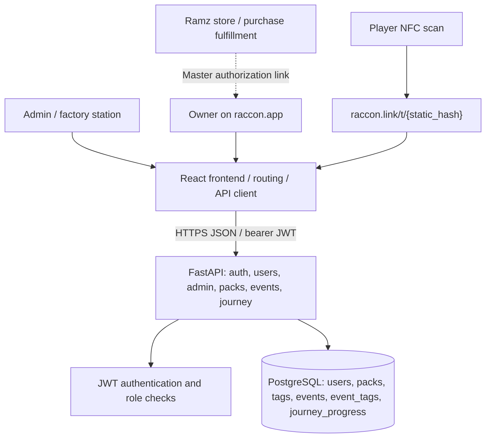
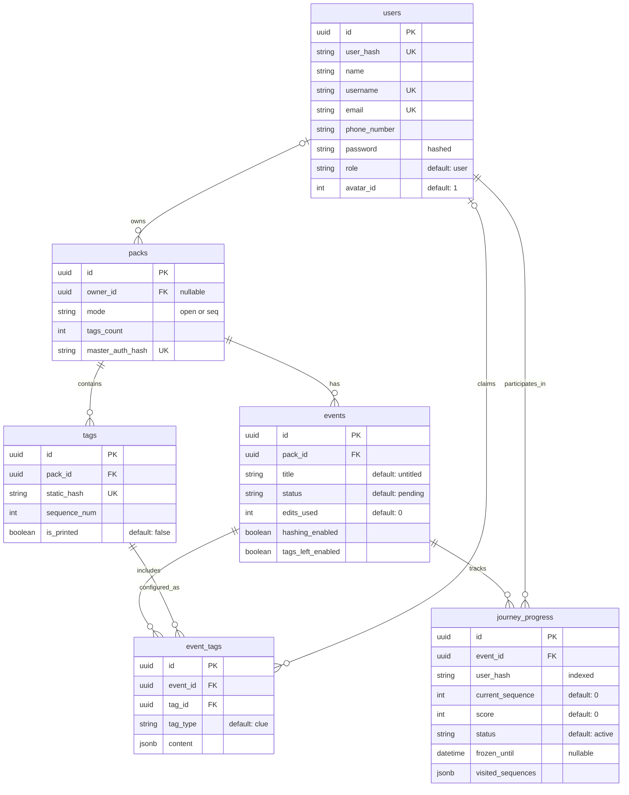
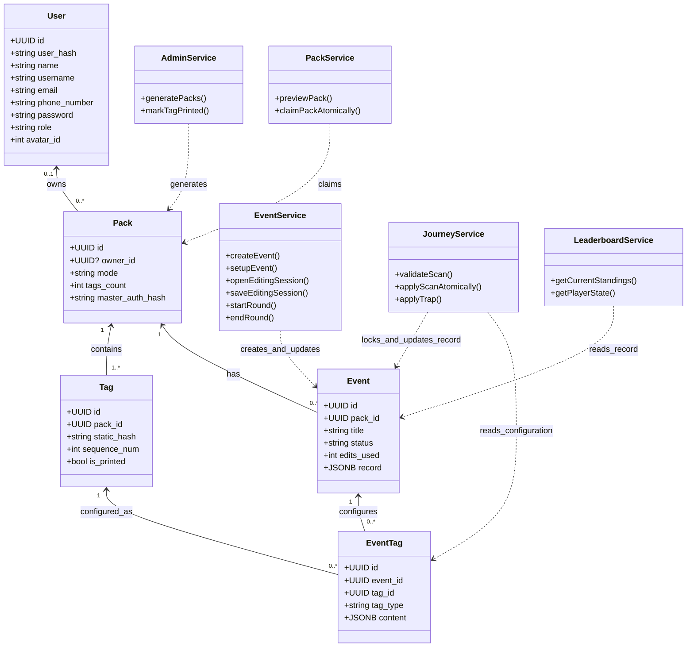
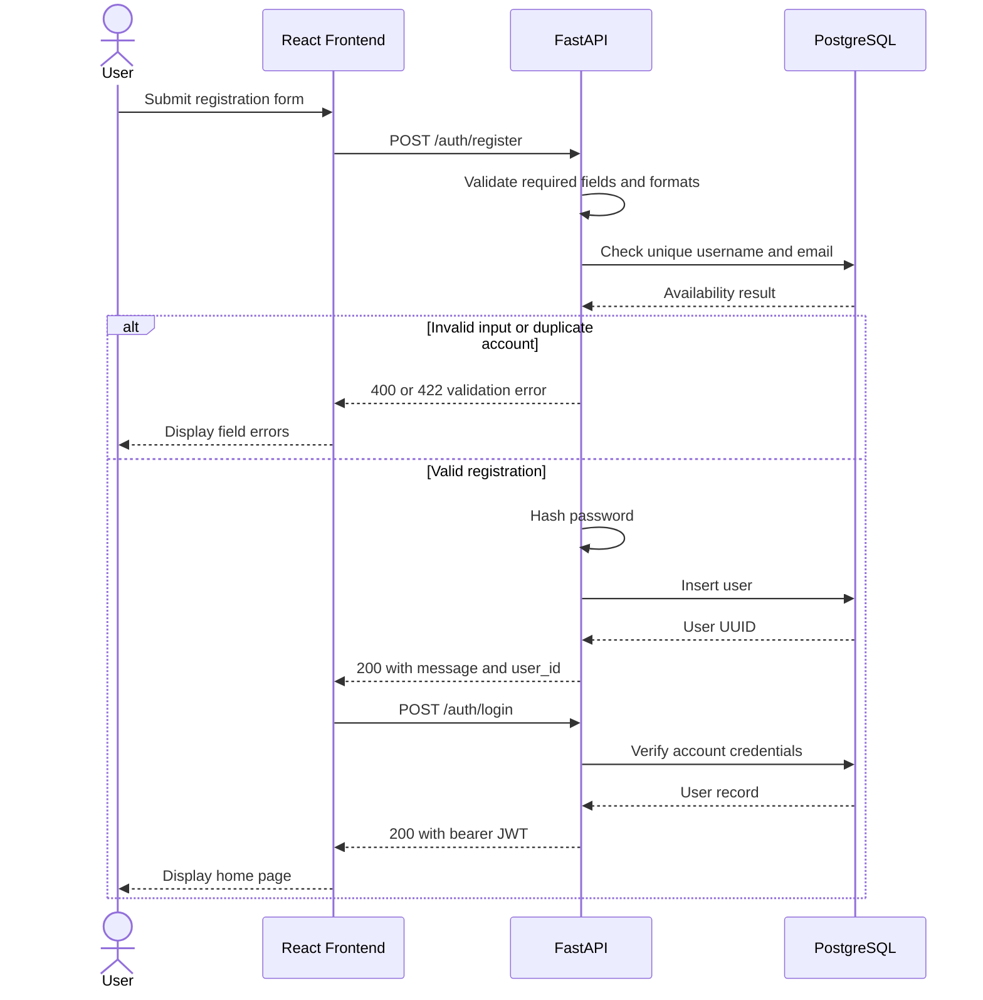
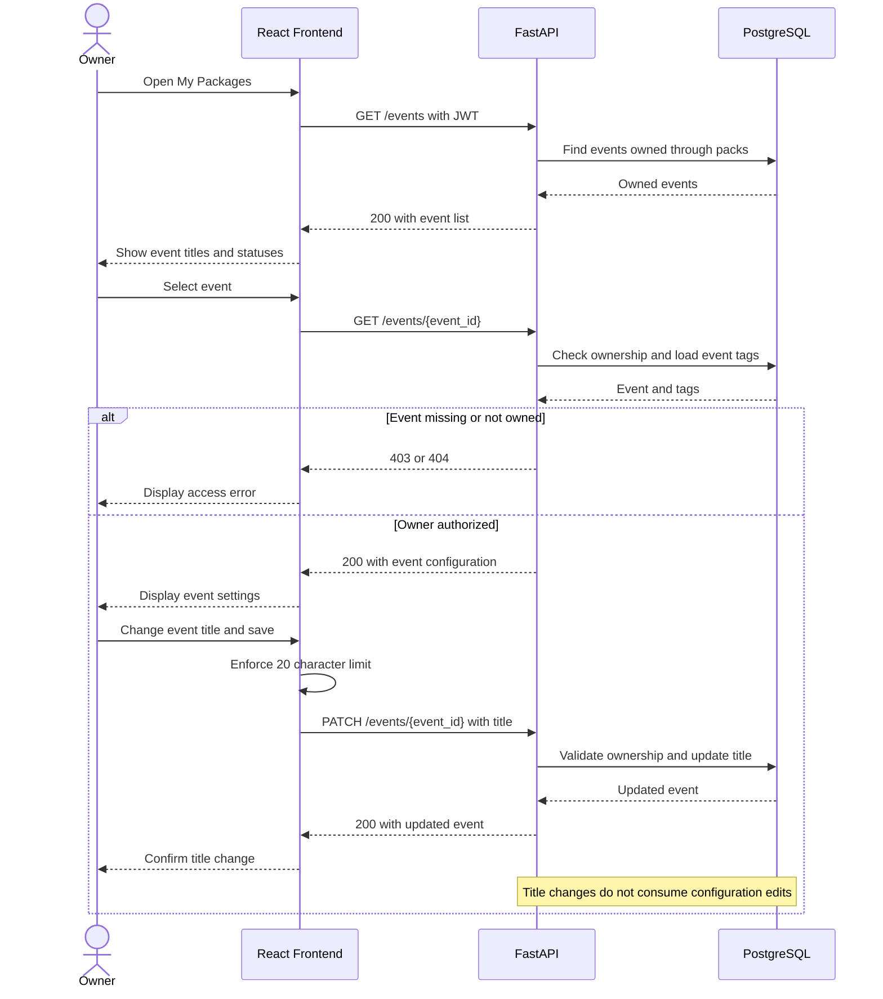
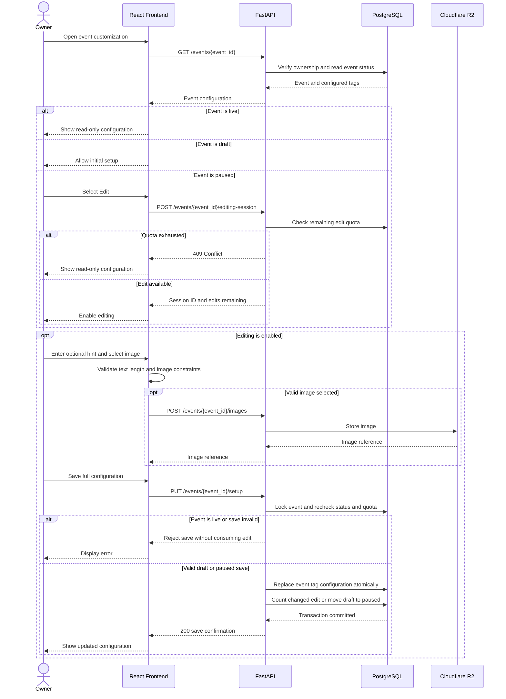
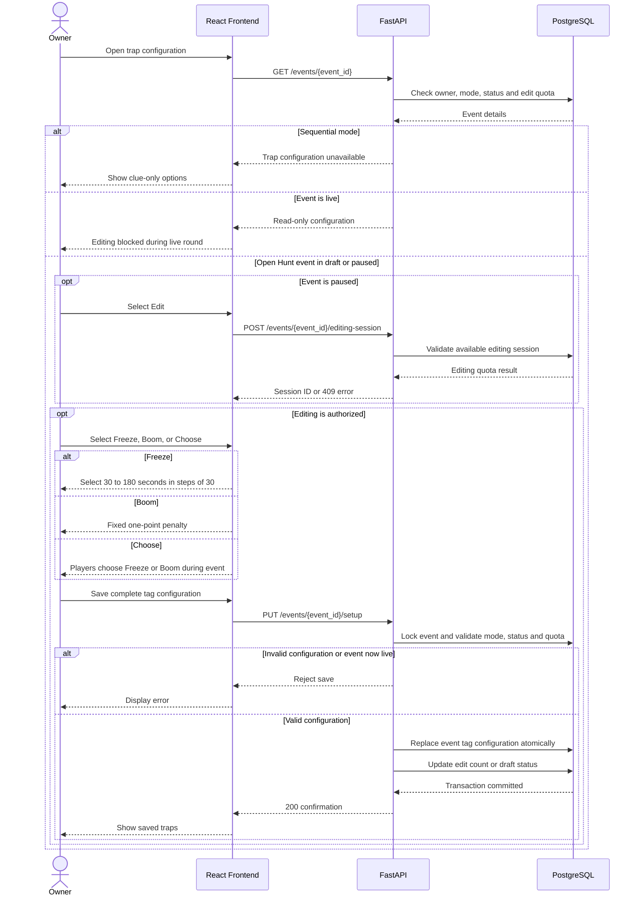

# Raccon Technical Documentation

## Table of Contents

- [Project Overview](#project-overview)
- [Terminology and Domain Rules](#terminology-and-domain-rules)
- [User Stories](#user-stories)
  - [Owner Stories](#owner-stories)
  - [Player Stories](#player-stories)
  - [Admin Stories](#admin-stories)
- [Figma Mockups](#figma-mockups)
- [System Architecture](#system-architecture)
- [High-Level Class Diagram](#high-level-class-diagram)
- [High-Level Sequence Diagrams](#high-level-sequence-diagrams)
- [Raccon REST API Documentation](#raccon-rest-api-documentation)
- [Technical Justifications](#technical-justifications)
- [Requirements Traceability](#requirements-traceability)
- [SCM and QA Plans](#scm-and-qa-plans)

## Project Overview

Raccon is an NFC-enabled platform for creating and playing physical, tag-based experiences. Administrators manufacture **packs** and program their NFC tags; customers claim purchased packs, thereby creating **events** that they can configure and publish; players scan the physical tags to view event content. The frontend is designed in React, the API is designed with FastAPI, and persistent data is stored in PostgreSQL.

## Terminology and Domain Rules

| Term | Meaning | Data model / API representation |
|---|---|---|
| **Pack** | Admin-generated physical inventory item containing a fixed set of NFC tags. It exists before purchase or claim. | `packs` |
| **Tag** | A physical NFC tag with a non-sequential public identifier and internal order number. | `tags` |
| **Master authorization token** | Unique, single-use claim credential identifying an unowned pack; Ramz delivers a link to the frontend claim page. | `packs.master_auth_hash` |
| **Event** | Owner-customizable experience created when a pack is claimed. | `events` |
| **Event tag** | Event-specific configuration for one physical tag, stored as JSONB. | `event_tags` |
| **Journey** | Player-facing tag scan operation for an active event. | `POST /journey/scan` |
| **`static_hash`** | Random, unique, public tag identifier, not the tag sequence number. | `tags.static_hash` |
| **`user_hash`** | Unique, randomly generated 8-character string assigned to each user to help prevent unauthorized access through shared NFC tag links. | `users.user_hash` |

### Event lifecycle

- **`draft`** — Created automatically at claim time; not scannable. The first non-empty successful setup request transitions it to `paused`.
- **`paused`** — Configuration has been saved; scanning is unavailable. The owner may edit and save the configuration or change the status to `live` through the event update endpoint.
- **`live`** — The scan endpoint accepts scans for this event and returns configured tag content. Configuration editing and saving are rejected until the owner ends the round and returns the event to `paused`.


### Identifier and ownership conventions

Owners are identified by `packs.owner_id`; an event inherits ownership through its associated pack. Admin privileges come from `users.role = "admin"`, verified after JWT authentication. The frontend must not treat public NFC URLs or client-supplied identifiers as proof of authorization.


## User Stories

The user stories below specify the complete intended Raccon experience. **Packs** are admin-generated physical inventory, while **events** are created when customers claim packs and are subsequently configured and managed by their owners. The user stories are prioritized according to the [MoSCoW prioritization table](../stage2/README.md), which establishes the relative importance of each feature.

## Owner Stories

### US-01: Registration

**Category:** Owner/Player &nbsp; · &nbsp; **Priority:** High

**User story**

> As a new visitor,
> I want to register an account,
> So I can buy NFC packs, manage my experiences, or participate in experiences as a player.

**Acceptance criteria**

- The visitor should be able to access the registration page without being signed in.
- If the user already has an account, they can navigate to the login page from the registration page.
- The visitor should be able to select an avatar from the available options, with the first avatar selected by default.
- The registration form should require a name, username, email address, phone number, and password.
- All the registration form fields are mandatory.
- The username and email must be unique and must not already belong to another Raccon account.
- If the entered username is already in use, the system should inform the visitor that the username is unavailable.
- If the entered email address is already registered, the system should inform the visitor that an account already exists with that email.
- The system should validate the format of the entered fields.
- The system should prevent registration until all mandatory fields contain valid values.
- Validation errors should be displayed clearly under the relevant field in red.
- The created account should be identifiable by the system as an owner or player according to the actions available to that user.
- After successful registration, the owner should be redirected to the Raccon platform.
- After successful registration, the player should be redirected to the NFC experience they were attempting to access.

---

### US-02: Log In

**Category:** Owner/Player &nbsp; · &nbsp; **Priority:** High

**User story**

> As a registered user,
> I want to log in to my Raccon account,
> So I can securely access my account.

**Acceptance criteria**

- The user should be able to log in using their username or email address and password.
- Invalid credentials should result in a generic error message without revealing whether a specific account exists.
- After successfully logging in, the user should remain authenticated until their session expires or they log out.
- An authenticated package owner should be able to access packages associated with their account.
- An authenticated player should be able to continue participating in an NFC experience.
- The user should be able to navigate to the Forgot Password page from the login page.
- If a player is redirected to log in after scanning an NFC tag, the system should return the player to the scanned tag after successful authentication.

---

### US-03: Log Out

**Category:** Owner &nbsp; · &nbsp; **Priority:** High

**User story**

> As a registered user,
> I want to log out of my Raccon account,
> So I can end my session when needed.

**Acceptance criteria**

- The authenticated user should be able to access a Log Out option.
- Selecting Log Out should end the user's current session.
- After logging out, the user should be redirected to the login page.
- The user should not be able to access authenticated pages without logging in again.

---

### US-04: Forgot Password

**Category:** Owner/Player &nbsp; · &nbsp; **Priority:** High

**User story**

> As a registered user,
> I want to reset my password if I forget it,
> So I can regain access to my Raccon account.

**Acceptance criteria**

- The sign-in page should display a "Forgot Password?" link.
- Clicking the link should redirect the user to the Forgot Password page.
- The user should be able to enter their registered email address.
- The system should validate the entered email address format.
- After submitting the email address, the system should display a confirmation message indicating that password reset instructions have been sent if the account exists.
- If the email address is associated with a Raccon account, the system should send a password reset link to that email address.
- The password reset link should be unique, time-limited, and usable only once.
- Clicking a valid reset link should redirect the user to a page where they can enter and confirm a new password.
- The system should validate the new password and ensure both password fields match.
- After successfully resetting the password, the system should display a confirmation message and allow the user to return to the sign-in page.
- The user should be able to log in using their new password.
- Expired or previously used reset links should be rejected with a clear error message.

---

### US-05: Manage Account

**Category:** Owner &nbsp; · &nbsp; **Priority:** High

**User story**

> As a registered user,
> I want to manage my Raccon account,
> So I can control my profile information and account settings.

**Acceptance criteria**

- The user should be able to view their profile information.
- The user should be able to edit their name, username, phone number or avatar.
- The user should be able to save changes to their profile information.
- The system should display a confirmation message after successfully saving profile changes.
- The user should be able to change their password.
- The user should be required to enter their current password before setting a new password.
- The system should validate the new password before saving it.
- The user should be able to delete their account.
- The system should request confirmation before permanently deleting the account.
- The user should be logged out after successfully deleting their account.

---

### US-06: Claim a Purchased Package

**Category:** Owner &nbsp; · &nbsp; **Priority:** High

**User story**

> As a registered user,
> I want to claim a package I purchased,
> So I can securely access my package and customize its experience.

**Acceptance Criteria**

- The user shall be able to view the available NFC pack options on the Raccon platform.
- Each pack option shall display its mode (Sequential or Open Hunt), number of NFC tags, and price.
- The user shall be able to select a pack and be redirected to its corresponding product page on Ramz to complete the purchase.
- After a successful purchase, Ramz shall send the customer a unique claim link, such as `https://raccon.app/claim?token=<master-auth-token>`.
- When the customer opens the claim link, the browser shall make an **HTTP GET request** to the React frontend route `/claim`, which displays the pack claim page and preserves the authorization token.
- If the customer is not authenticated, the system shall require them to log in or register while preserving the claim token.
- The React frontend shall display a confirmation action before claiming the pack.
- When the customer confirms, the React frontend shall send an **authenticated HTTP POST request** to the FastAPI endpoint `POST /packs/claim`, including the authorization token in the JSON request body and the customer's JWT in the authorization header.
- The backend shall validate the authorization token and verify that the pack has not already been claimed.
- If the claim is valid, the system shall assign the pack to the authenticated customer and create exactly one event with the initial status `draft`.
- If the token is invalid or already used, the system shall reject the claim and display an appropriate error message without changing pack ownership or creating an event.
- A pack that has already been claimed shall not be claimable by another account.
- After a successful claim, the event shall appear in the customer's owned events list.
- The customer shall be able to access the customization page for the claimed event.
- The physical pack and its NFC tags shall exist before claiming; the claim process shall not create or modify physical tags.
---

### US-07: View and Manage Purchased NFC Packages

**Category:** Owner &nbsp; · &nbsp; **Priority:** High

**User story**

> As an NFC event owner,
> I want to view and identify the NFC packs associated with my account,
> So I can access and manage my purchased experiences.

**Acceptance criteria**

- The owner should be able to view all NFC packs associated with their account.
- A newly claimed pack should use “Untitled” as its default Event Title.
- Package names can be duplicates.
- Each package should display:
  - Event Title
  - Event ID
  - Mode: Sequential or Open Hunt
  - Number of NFC tags
  - Current status
- The Event ID, mode and number of tags should not be editable.
- The package status should not be directly editable by changing the event information.
- The event title should be editable independently of tag configuration.
- The event title field should have a maximum length of 20 characters.
- The owner should be able to rename the event at any time without an edit limit.
- Renaming the event should not count toward the event's customization edit limit.
- The owner should only be able to access packages associated with their account.
- Selecting a package should allow the owner to access its customization interface.
- Previously saved event configurations should remain available when the owner returns to the event.
- `GET /events` should list the owner’s events; `GET /events/{event_id}` should provide the selected event’s configuration details.
- `PATCH /events/{event_id}` should update the event title and control status changes, including transition to `live`.


---

### US-08: NFC Package Customization

**Category:** Owner &nbsp; · &nbsp; **Priority:** High

**User story**

> As an NFC event owner,
> I want to customize the individual tags in my package,
> So I can create experiences that fit my intended activity.

**Acceptance criteria**

- The customization dashboard should display all NFC tags belonging to the selected package.
- Tags should be displayed as numbered circles in ascending order.
- The total number of displayed tags should match the number of tags included in the claimed pack.
- The first tag should be selected by default when the customization dashboard is initially opened.
- Selecting another tag should load that tag's current configuration into the customization area.
- The currently selected tag should be visually distinguishable from the remaining tags via hover effect.
- The empty tags, configured tags and current tag should be visually distinguishable.
- The customization area should clearly display the number of the tag currently being edited.
- The owner should be able to configure tags individually while remaining within the same event customization session.
- The owner should be able to save the completed event configuration.
- `PUT /events/{event_id}/setup` should save the event-specific tag configurations; the first successful non-empty setup should transition the event from `draft` to `paused`.
- Event configuration must not modify the physical pack’s immutable tag identifiers or ordering.

---

### US-09: Customize Tag Content

**Category:** Owner &nbsp; · &nbsp; **Priority:** High

**User story**

> As an NFC event owner,
> I want to add content to an individual NFC tag,
> So players receive the intended hint or information when they discover that tag.

**Acceptance criteria**

- The owner should be able to add optional hint text to a tag.
- Hint text should have a maximum length of 255 characters and minimum of 0 characters.
- The interface should display the current character count.
- The owner should not be able to enter more than 255 characters.
- The text field should use the Thmanyah font, a font size of 18px, and the color `#2D3B33`.
- The owner should be able to optionally upload an image.
- Supported image formats should be JPG, PNG, and WEBP.
- An uploaded image should not exceed 5 MB.
- Unsupported files should be rejected with a clear validation message.
- Images larger than 5 MB should be rejected with a clear validation message.
- If replacing an existing image fails validation, the previously saved image should remain unchanged.
- Text and image content should both be optional, allowing the owner to configure a tag with text only, an image only, both, or no content.
- Saving should persist the selected tag’s configuration through the event setup request, which submits the event’s tag configuration set.
- After a successful save, the interface should provide confirmation that the tag was saved.
- Successfully configuring a previously empty tag should update the event configuration progress.
- Navigating away from a tag with unsaved changes should warn the owner before those changes are discarded.
- Tag content should be represented by `event_tags.content` as JSONB, using `hint` and `image` fields for clue tags.
- The backend should validate tag membership and event ownership before replacing event tag configurations.

---

### US-10: Edit a Saved Package Configuration

**Category:** Owner &nbsp; · &nbsp; **Priority:** High

**User story**

> As an NFC event owner,
> I want to edit a previously saved event configuration,
> So I can correct or update the experience after its initial customization.

**Acceptance criteria**

- A package should allow a maximum of three editing sessions after its initial configuration is saved.
- The edit limit should apply to the entire package, not to individual tags.
- A saved package should not be directly editable until the owner explicitly selects Edit, and editing is permitted only while the event is `paused`.
- Selecting Edit should open the entire package for editing.
- Once editing is enabled while the event is `paused`, the owner should be able to modify any configurable tag or package-level setting as they would during the initial customization.
- Editing only one tag should still count as one event editing session.
- Editing multiple tags during the same editing session should still count as only one package edit.
- The interface should display how many event edits remain.
- Entering the customization page without making and saving changes should not consume an edit.
- Previewing the event should not consume an edit.
- Discarding changes should not consume an edit.
- An edit should only be consumed when changes from an editing session are successfully saved while the event is `paused`. Saves attempted while `live` shall be rejected without consuming an edit.
- When one edit remains, the system should warn the owner before saving that this will use the event's final edit.
- Once all three event edits have been used, the event configuration should become read-only.
- The Event Title should remain editable even when no customization edits remain.


---

### US-11: Configure Freeze Trap

**Category:** Owner &nbsp; · &nbsp; **Priority:** Medium

**User story**

> As an Open Hunt NFC event owner,
> I want to assign a Freeze trap to selected NFC tags,
> So I can temporarily prevent players from continuing the experience.

**Acceptance criteria**

- The owner should be able to configure an individual tag as a Freeze trap.
- Only one trap type should be assigned to a tag at a time.
- When the owner selects Freeze, they should be prompted to specify the Freeze duration.
- The Freeze duration should be selectable in 30-second increments, ranging from 30 seconds to 3 minutes.
- Values outside the allowed range should not be accepted.
- The Freeze configuration should only become active after the event configuration is successfully saved.
- Changes to the Freeze configuration after the initial save should follow the event editing rules defined in US-10.
- A player who successfully scans the tag should be frozen for the configured duration.
- While frozen, the player should not be able to successfully scan another tag.
- The Freeze countdown should be tracked independently for each player.
- Re-scanning the same Freeze tag while frozen should display the remaining time without restarting the countdown.
- A Freeze tag should never become claimed and should remain available to all players throughout the experience.
- Freeze settings should be represented within the trap tag’s event-specific JSONB content.

---

### US-12: Configure Boom Trap

**Category:** Owner &nbsp; · &nbsp; **Priority:** Medium

**User story**

> As an Open Hunt NFC event owner,
> I want to assign a Boom trap to selected NFC tags,
> So I can introduce point penalties into the experience.

**Acceptance criteria**

- The owner should be able to configure an individual tag as a Boom trap.
- Only one trap type should be assigned to a tag at a time.
- When the owner selects Boom, the point deduction should be fixed at one point.
- The Boom configuration should only become active after the event configuration is successfully saved.
- Changes to the Boom configuration after the initial save should follow the event editing rules defined in US-10.
- A player who successfully scans the tag should lose one point.
- A player's score should never fall below zero.
- A Boom tag should never become claimed and should remain available to all players throughout the experience.
- The same player should not be able to trigger the same Boom tag twice consecutively.
- Re-scanning the same Boom tag consecutively should not result in an additional point deduction.
- After successfully scanning a different tag, the player should be able to trigger the previous Boom tag again.
- One player's interaction with a Boom tag should not affect another player's ability to trigger it.
- Boom settings should be represented within the trap tag’s event-specific JSONB content.

---

### US-13: Configure Choose Trap

**Category:** Owner &nbsp; · &nbsp; **Priority:** Medium

**User story**

> As an Open Hunt NFC event owner,
> I want to assign a Choose Trap to selected NFC tags,
> So players can determine the trap behavior encountered by subsequent scanners during the experience.

**Acceptance criteria**

- The owner should be able to configure an individual tag as a Choose Trap.
- Only one trap type should be assigned to a tag at a time.
- The Choose Trap configuration should only become active after the event configuration is successfully saved.
- Changes to the Choose Trap configuration after the initial save should follow the event editing rules defined for event customization.
- A Choose Trap tag should never become claimed and should remain available throughout the Open Hunt experience.
- Multiple players should be able to interact with the same Choose Trap tag.
- When a player is allowed to configure the trap, they should be able to choose between Freeze and Boom.
- Selecting Freeze should prompt the player to specify a duration selectable in 30-second increments, ranging from 30 seconds to 3 minutes.
- Selecting Boom should configure a deduction of one point.
- The player should only be able to select one trap type.
- The confirmed choice takes effect immediately and remains active for subsequent eligible scans until replaced. The effect can include the chooser; the precise set of players affected immediately must be specified in the rules.
- The player who configures the trap is also subject to its effect on a later eligible scan.
- Any Freeze or Boom behavior configured through Choose Trap should follow the same player-specific rules as a directly configured Freeze or Boom tag.
- set-trap configuration should be represented within the trap tag’s event-specific JSONB content.

---

### US-14: Preview Sequential Tag Experience

**Category:** Owner &nbsp; · &nbsp; **Priority:** Medium

**User story**

> As a sequential NFC event owner,
> I want to preview a tag before saving or publishing it,
> So I can understand what the player will see when the tag is scanned.

**Acceptance criteria**

- A Preview button should be available in the tag customization interface.
- Clicking Preview should display a mobile representation of the player's scan-result screen.
- The preview should use the selected tag's current configuration, including unsaved changes.
- The preview should display a circle containing the selected tag number.
- The preview should display the "ﺣﺻﻠﺗﮭﺎ!" heading used in the player experience.
- The preview should display the configured hint text when present.
- The preview should display the configured image when present.
- The preview should use a fixed Sequential experience layout, regardless of the event being customized.
- The preview should display a generic leaderboard with sample player information rather than actual player rankings.
- Opening or closing the preview should not save the event configuration or consume an available package edit.

---

### US-15: Preview Open Hunt Tag Experience

**Category:** Owner &nbsp; · &nbsp; **Priority:** Medium

**User story**

> As an open hunt NFC event owner,
> I want to preview a tag before saving or publishing it,
> So I can understand what the player will see when the tag is scanned.

**Acceptance criteria**

- A Preview button should be available from the tag customization interface.
- Clicking Preview should display a mobile representation of the player's scan-result screen.
- The preview should use the tag's current configuration, including unsaved changes.
- The preview should display a circle with the selected tag number.
- The preview should display the "ﺣﺻﻠﺗﮭﺎ!" heading used in the player experience.
- The preview should display the configured hint text when present.
- The preview should display the configured image when present.
- The preview should use a fixed Open Hunt experience layout, regardless of the event being customized.
- The preview should display a generic leaderboard with sample player information.
- Opening or closing a preview should not save the tag or consume one of the available edits.

## Player Stories

### US-16: Scan a Hashed NFC Tag

**Category:** Player &nbsp; · &nbsp; **Priority:** Medium

**User story**

> As a player,
> I want to access the correct event tag by scanning its unique NFC URL,
> So I can participate securely in a live Raccon experience.

**Acceptance criteria**

- Each physical tag should contain a URL in the format `https://raccon.link/t/{static_hash}`.
- `static_hash` should be a unique identifier that does not reveal the tag's internal sequence number.
- Opening the NFC URL should resolve the corresponding physical tag without exposing its ordering in the link.
- A player who is not authenticated should be redirected to sign in and then returned to the intended tag.
- The frontend should submit the tag's `static_hash` as `tag_hash` to `POST /journey/scan`.
- The scan request should include `injected_user_hash`, containing the authenticated player's UUID.
- The backend should compare that UUID with the user ID in the JWT and reject a mismatch.
- A nonexistent tag hash should be rejected without changing progress or score.
- The backend should reject scans when the associated event has status `draft` or `paused`.
- Only tags belonging to an event with status `live` should be eligible for a successful scan.
- Rejected scans should not award points, advance progress, or trigger traps.
- The scan response should identify the tag's sequence number, configured type, and event-specific content as applicable.

---

### US-17: View Successful Sequential Scan Result

**Category:** Player &nbsp; · &nbsp; **Priority:** High

**User story**

> As a player,
> I want to see the result of a successful sequential NFC scan,
> So I know which tag I discovered and can receive its clue or content.

**Acceptance criteria**

- After a successful scan, the player should see the "ﺣﺻﻠﺗﮭﺎ!" heading.
- The scanned tag number should be prominently displayed inside a numbered circle.
- The configured hint text should be displayed when the owner has provided one.
- The configured image should be displayed when the owner has provided one.
- If neither text nor an image is configured, the scan result should still display the relevant tag information.
- If Tags Left is enabled, the number of remaining tags should be displayed.
- If Tags Left is disabled, this information should not be displayed.
- The player's progress should be updated.
- The player should be able to access the sequential leaderboard from the scan-result interface.

---

### US-18: View Successful Open Hunt Scan Result

**Category:** Player &nbsp; · &nbsp; **Priority:** High

**User story**

> As a player,
> I want to see the result of a successful open hunt NFC scan,
> So I can earn its points before another player claims it.

**Acceptance criteria**

- After a successful scan, the player should see the "ﺣﺻﻠﺗﮭﺎ!" heading.
- The configured hint text should be displayed when the owner has provided one.
- The configured image should be displayed when the owner has provided one.
- If neither text nor an image is configured, the scan result should still display the relevant tag information.
- The first player to successfully scan an unclaimed normal tag in the current round should claim that tag.
- The first player to claim the tag should receive exactly one point.
- A tag claimed by Player A should no longer award points to Player B, Player C, or any other player.
- Re-scanning a tag already claimed by the same player should also award no additional points.
- The player should be able to see their current score.
- If Tags Left is enabled, the number of remaining tags should be displayed.
- If Tags Left is disabled, this information should not be displayed.
- The player's score should be updated.
- The player should be able to access the open hunt leaderboard from the scan-result interface.

---

### US-19: Experience a Freeze Trap

**Category:** Player &nbsp; · &nbsp; **Priority:** Medium

**User story**

> As an open hunt player,
> I want clear feedback when I activate a Freeze trap,
> So I understand why I temporarily cannot continue scanning tags.

**Acceptance criteria**

- Scanning a tag configured with a Freeze trap should activate the configured Freeze duration.
- The player should be shown a dedicated Freeze screen.
- The Freeze screen should clearly indicate that the player has been frozen.
- A countdown should display the remaining Freeze duration.
- While frozen, attempts to scan other Raccon tags should not be counted as successful scans.
- Scanning another tag during the Freeze period should return the player to the Freeze state and show the remaining time.
- The Freeze duration should continue from the original activation and should not restart because another tag was scanned.
- No points or progression should be awarded for scans rejected during the Freeze period.
- Re-scanning the same freeze tag while already frozen should display the player's existing countdown rather than starting a new Freeze period.
- Once the countdown reaches zero, the player should automatically become eligible to scan tags again.

---

### US-20: Experience a Boom Trap

**Category:** Player &nbsp; · &nbsp; **Priority:** Medium

**User story**

> As an open hunt player,
> I want the result of a Boom trap to be reflected in my score,
> So I can understand the consequence of discovering that tag.

**Acceptance criteria**

- Scanning a tag containing a Boom trap should activate its configured point deduction.
- The configured number of points should be deducted from the player's current score.
- The player's score should never become negative.
- If the deduction exceeds the player's current score, the resulting score should be zero.
- The updated score should be reflected in the player's experience.
- The leaderboard should reflect the player's updated score.
- The scan should record that the Boom trap was triggered.

---

### US-21: View Leaderboard

**Category:** Player &nbsp; · &nbsp; **Priority:** Medium

**User story**

> As a player,
> I want to view the experience leaderboard,
> So I can compare my performance with other players.

**Acceptance criteria**

- The leaderboard should be accessible from the player's scan-result screen.
- The leaderboard should be displayed in a scrollable sheet.
- Each leaderboard entry should display the player's rank, player identity/display name, and score.
- A player’s sequential leaderboard value should represent the highest consecutively completed sequential tag in the current round.
- A player's open hunt leaderboard score should reflect one point per first-claimed normal tag, adjusted by Boom penalties, in the current round.
- The current player's entry should be visually distinguishable from other entries.
- The leaderboard should reflect changes resulting from valid scans and trap effects.
- The player's leaderboard information should refresh after their scan affects their score or progression.

## Admin Stories

### US-22: Prepare an NFC Package

**Category:** Admin &nbsp; · &nbsp; **Priority:** High

**User story**

> As an admin,
> I want to program and lock each NFC tag with its assigned URL,
> So I can prepare a complete physical Raccon package for customers.

**Acceptance criteria**

- The admin should be able to enter a Event ID to load the event configuration and required NFC tags.
- The programming station should indicate which tag to scan next and display the package's programming progress.
- If a scanned tag already contains data, the station should display a red warning and play an error sound.
- A tag containing existing data should not be programmed, and the package's progress should remain unchanged.
- The station should prompt the admin to scan a blank NFC tag.
- If the scanned tag is blank, the station should write its assigned unique URL and apply the configured NDEF/password lock.
- A tag should only be considered successfully programmed after both writing and locking are completed.
- After successful programming and locking, the station should record the tag as "printed" in the backend.
- Once the backend confirms the tag's status, the station should play a success sound and advance to the next tag.
- If programming, locking, or backend recording fails, the station should display an error message and should not count the tag as completed.
- When all required tags are successfully recorded as printed, the station should display "Order 100% Complete."
- Admin authentication should use the same account login flow with authorization enforced through the `admin` role.
- The pack generation operation should assign each pack a master authorization token and each physical tag a unique `static_hash`, UUID, and internal `sequence_num`.
- The admin should retrieve the master authorization link for distribution through Ramz and the ordered factory URLs for NFC programming.
- The master authorization link should lead to the claim flow; claiming the pack should create its event only when a customer successfully claims it.
- Marking a tag as printed must require a successful programming and locking result.

## Figma Mockups

The [Raccon Figma workspace](https://www.figma.com/design/Hdv2zuWiZN8ltgtFmr4mhZ/Raccon-%25E2%2580%2594-User-Stories--Design-System---Mockups?node-id=325-34&p=f&t=XIrNazSEfBlfXD9l-0) brings together project requirements, design foundations, and interface mockups. Its pages are organized into the following sections:

- **Cover and Index:** Introduce the project and track changes and handoff status.
- **Admin:** Documents the brief and user stories in English and Arabic, alongside the sitemap, user flows, and architecture.
- **Foundations:** Defines the brand identity, logo, characters, authentication animation, design tokens for color, typography and spacing, reusable components, and interface copy in Saudi dialect.
- **Intake:** Collects team requests and feedback, with a sandbox for design explorations.

This structure connects the user stories to the design work and gives the team a shared reference for review and implementation.

## System Architecture



### Architecture Layers

| Layer | Technology | Responsibility |
|---|---|---|
| Presentation | React (project frontend) | Owner and player screens, tag-link routing, factory interface, request composition |
| API | FastAPI, Pydantic | Request validation, authentication, authorization, event lifecycle, tag scanning |
| Data access | SQLModel / SQLAlchemy | Models, queries, and transactional persistence |
| Database | PostgreSQL | Users, packs, tags, events, and JSONB event-specific tag content |
| Migrations | Alembic | Versioned relational schema evolution |
| External systems | Ramz , NFC writing station | Purchase handoff and physical tag programming |


### Operational Data Flow

1. An admin generates a pack and its physical tags before a customer owns it.
2. The factory station retrieves the ordered `raccon.link` URLs, writes them to tags, and marks successful writes as printed.
3. Ramz provides the buyer with a master authorization link. The owner authenticates and submits the token to the claim API.
4. Claiming assigns the pack to the owner and creates an event in `draft` status.
5. The owner retrieves the event, saves the event-specific tag content, and changes the event to `live` using the update endpoint.
6. A player opens an NFC link; the frontend submits the unique tag hash and authenticated user's UUID to the journey scan endpoint.
7. FastAPI checks the JWT user identity, resolves the physical tag, selects the event for the pack, verifies `live` status, and returns content.


### Entity Relationship Diagram


### Database Overview

| Table | Responsibility |
|---|---|
| `users` | Stores user credentials, profile information, selected avatars, and account roles. |
| `packs` | Stores generated NFC packages, ownership information, gameplay modes, and claiming credentials. |
| `tags` | Stores physical NFC tag identifiers, sequence numbers, and programming status. |
| `events` | Stores event configurations, editing limits, and event-level settings such as NFC tag hashing. |
| `event_tags` | Stores event-specific NFC tag content and trap configurations using JSONB. |
| `journey_progress` | Tracks individual player progress, scores, visited tags, gameplay status, and active trap effects within an event. |

## High-Level Class Diagram




### Class Overview

| Class | Responsibility |
|---|---|
| `User`, `Pack`, `Tag`, `Event`, `EventTag` | Persisted PostgreSQL entities representing accounts, physical inventory, and event configurations. |
| `AdminService`, `PackService` | Package generation, factory programming, and secure package claiming. |
| `EventService` | Event creation, configuration, editing limits, and round lifecycle management. |
| `JourneyService` | NFC scan validation, Sequential progression, Open Hunt claims, scores, traps, and atomic gameplay updates. |
| `LeaderboardService` | Retrieves current-round rankings, scores, and player progress from `events.record`. |


## High-Level Sequence Diagrams

The following diagrams describe registration, event management, tag configuration, and event. Configuration can be saved during initial `draft` setup or while `paused`, but not while `live`.

### 1. User Registration



### 2. View and Rename Packages



### 3. Configure NFC Tag Content



### 4. Configure NFC Tag Traps



### 5. NFC Tag Scanning and Event


### Sequence Diagram Overview

| Diagram | Description |
|---|---|
| User Registration | Validates account details, creates a user, and logs them in through a separate authentication request. |
| View and Rename Packages | Lists owned events, checks ownership, and renames an event without consuming configuration edits. |
| Configure NFC Tag Content | Saves clues and R2 image references, respecting draft setup, paused-only editing, and editing quotas. |
| Configure NFC Tag Traps | Configures Open Hunt traps with validation and paused-only editing rules. |
| NFC Tag Scanning and Event | Authenticates players, processes live scans and trap effects, and updates current-round event in `events.record`. |


## Raccon REST API Documentation

### API conventions

- **Authentication:** Protected endpoints require `Authorization: Bearer <access_token>`. JWTs use HS256, include the user UUID in `sub`, and expire after seven days. 
- **Admin access:** Admin endpoints additionally require `users.role = "admin"`.
- **Reference documentation:** FastAPI generates `/openapi.json`, `/docs`, and a Scalar UI at `/scalar`.

### Endpoint Summary

| Method | Path | Access | Purpose |
|---|---|---|---|
| `POST` | `/auth/register` | Public | Register account |
| `POST` | `/auth/login` | Public | Obtain JWT |
| `POST` | `/auth/logout` | User | Logout acknowledgment |
| `POST` | `/auth/change-password` | User | Change password |
| `DELETE` | `/auth/delete-account` | User | Delete account |
| `GET` | `/users/me` | User | View profile |
| `PATCH` | `/users/me` | User | Update profile |
| `POST` | `/admin/generate-packs` | Admin | Generate inventory |
| `GET` | `/admin/factory/pack/{pack_id}` | Admin | Factory tag URLs |
| `PATCH` | `/admin/factory/tags/{tag_id}/mark-printed` | Admin | Mark tag programmed |
| `GET` | `/packs/preview/{master_auth_hash}` | Public | Preview claimable pack |
| `POST` | `/packs/claim` | User | Claim pack and create draft event |
| `GET` | `/events` | User | List owned events |
| `GET` | `/events/{event_id}` | Owner | View event and tag configuration |
| `PUT` | `/events/{event_id}/setup` | Owner | Replace event tag configuration |
| `PATCH` | `/events/{event_id}` | Owner | Rename or change event status |
| `POST` | `/journey/scan` | User | Scan live event tag |
| `GET` | `/` | Public | Root check |
| `GET` | `/health/` | Public | Health check |
| `GET` | `/scalar` | Public | Interactive API reference |
| `POST` | `/auth/forgot-password` | Public | Begin password recovery |
| `POST` | `/auth/reset-password` | Public | Finish password recovery |
| `GET` | `/events/{event_id}/leaderboard` | User | Leaderboard |
| `POST` | `/journey/set-trap` | User | Confirm a persistent Choose Trap selection |
| `POST` | `/events/{event_id}/editing-session` | Owner | Explicitly open a configuration editing session |
| `POST` | `/events/{event_id}/images` | Owner | Upload a tag image to Cloudflare R2 |

# Raccon API Documentation

The API specification is divided into **internal APIs**, which support Raccon's own application and administrative workflows, and **external services and integrations**, which support infrastructure, deployment, observability, and third-party commerce. Internal endpoints are grouped by responsibility and documented consistently using access, request, response, and key rules. UUIDs and example tokens below are illustrative.

## 1. Internal APIs

### 1.1 Authentication and profile

| Endpoint | Access | Request | Successful response | Validation and important behavior |
|---|---|---|---|---|
| `POST /auth/register` | Public | JSON: `name`, `username`, `email`, `phone_number`, `avatar_id`, `password` | `200`: `message`, `user_id` (UUID) | Username `^[a-z0-9_]+$`; phone `^\d{9}$`; password max 72 characters; duplicate username/email: `400`. Uniqueness is enforced by the database. |
| `POST /auth/login` | Public | Form: `username`, `password`; username field accepts a username or email | `200`: `access_token`, `token_type: "bearer"` | Invalid credentials: `400`. The access token is a JWT. |
| `POST /auth/logout` | Authenticated user | Bearer JWT; no body | `200`: `{"message":"Successfully logged out."}` | The frontend discards the JWT; logout does not revoke an already issued access token. |
| `POST /auth/change-password` | Authenticated user | JSON: `old_password`, `new_password` | `200`: `{"message":"Password changed successfully"}` | Incorrect current password: `400`; enforce password validation. |
| `DELETE /auth/delete-account` | Authenticated user | Bearer JWT; no body | `200`: `{"message":"Account deleted successfully"}` | Preserve referential integrity and apply the defined ownership and retention policy. |
| `GET /users/me` | Authenticated user | No body | `200`: `id`, `name`, `username`, `email`, `phone_number` | Returns the authenticated user's profile. |
| `PATCH /users/me` | Authenticated user | JSON: optional `name`, `username`, `phone_number` | `200`: updated user profile | `email` and `role` are not editable here; duplicate username is rejected. |

### 1.2 Admin inventory and factory programming

| Endpoint | Access | Request | Successful response | Validation and important behavior |
|---|---|---|---|---|
| `POST /admin/generate-packs` | Admin | JSON: `mode` (`open` or `seq`), `tags_count`, `quantity` | `200`: array of generated packs with `pack_id`, `master_auth_hash`, and tags (`id`, `static_hash`, `sequence_num`, `is_printed`) | `quantity ≥ 1`; `tags_count > 0`; each tag has a unique six-character random `static_hash`. |
| `GET /admin/factory/pack/{pack_id}` | Admin / authorized factory workflow | Path: `pack_id` (UUID) | `200`: `pack_id`, `mode`, ordered `tags_to_program` containing `tag_id`, `sequence_num`, `print_url`, `is_printed` | Unknown pack: `404`; print URL: `https://raccon.link/t/{static_hash}`. |
| `PATCH /admin/factory/tags/{tag_id}/mark-printed` | Admin / authorized factory workflow | Path: `tag_id` (UUID) | `200`: `status: "success"`, confirmation `message` | Unknown tag: `404`; factory verifies NFC writing and locking before marking printed. |

**Generation request example:**

```json
{"mode":"open","tags_count":5,"quantity":2}
```

### 1.3 Pack claiming

| Endpoint | Access | Request | Successful response | Validation and important behavior |
|---|---|---|---|---|
| `GET /packs/preview/{master_auth_hash}` | Public | Path: `master_auth_hash` | `200`: `id`, `mode`, `tags_count`, `owner_id` | Invalid token: `404`; claim eligibility is checked before confirmation. |
| `POST /packs/claim` | Authenticated user | JSON: `master_auth_hash` | `200`: claimed pack `id`, `mode`, `tags_count`, `owner_id` | Token must be valid, single-use, and linked to an unclaimed pack. Assign owner and create exactly one `draft` event in the same database transaction; reject repeated or concurrent claims. |

**Claim request example:**

```json
{"master_auth_hash":"<master-token-from-purchase-link>"}
```

The customer follows a Ramz-provided link to the **React frontend** at `GET https://raccon.app/claim?token=...`. After authentication and explicit confirmation, React sends `POST /packs/claim` to FastAPI. Opening the frontend link alone does not claim the pack.

### 1.4 Event configuration and lifecycle

| Endpoint | Access | Request | Successful response | Validation and important behavior |
|---|---|---|---|---|
| `GET /events` | Authenticated user | No body | `200`: array of `id`, `pack_id`, `title`, `status`; empty array if none | Returns events belonging to packs owned by the caller. |
| `GET /events/{event_id}` | Pack owner | Path: `event_id` (UUID) | `200`: `id`, `pack_id`, `title`, `status`, and ordered `tags` with `sequence_num`, `tag_id`, `tag_type`, `content`, `is_configured` | Unknown event: `404`; non-owner: `403`; includes physical tags even if not configured. |
| `PUT /events/{event_id}/setup` | Pack owner | JSON: `tags_config` array of `tag_id`, `tag_type`, `content` | `200`: `{"status":"success","message":"Event journey setup completed."}` | Setup is permitted only in `draft` (initial setup) or `paused` (subsequent edits); reject requests while `live`. `clue` or `trap`; traps only in `open` mode; trap content needs a non-null `boom`, `freeze`, or `choose`. Initial nonempty setup changes `draft → paused`. Empty list after initial setup rejected. Unknown: `404`; non-owner: `403`; invalid mode: `400`; invalid schema: `422`. |
| `PATCH /events/{event_id}` | Pack owner | JSON: optional `title`, `status` | `200`: updated `id`, `pack_id`, `title`, `status` | `draft → paused` occurs through setup; owner controls allow `paused ↔ live`; never return to `draft`. Cannot start without valid configuration. Title changes do not consume an editing session. Unknown: `404`; non-owner: `403`; invalid status: `422`. |
| `POST /events/{event_id}/editing-session` | Event owner | Path: `event_id` (UUID) | `200`: `editing_session_id` (UUID), `edits_remaining` | After initial setup, explicitly opens a session. First successful changed save in the session consumes one of three edits; repeated/no-op saves do not. Session ID accompanies setup submissions. Quota exhausted: `409`. Opening an editing session while `live` is rejected; the owner must end the round and return to `paused` before editing. |


### 1.5 Player journey and Event

| Endpoint | Access | Request | Successful response | Validation and important behavior |
|---|---|---|---|---|
| `POST /journey/scan` | Authenticated player | JSON: `tag_hash`, `injected_user_hash` (UUID) | `200`: scan outcome and tag information; event contract includes `result`, `tag_sequence`, `tag_type`, `content`, `round_id`, `points_delta`, `score`, `highest_sequential_tag`, `claimed`, `frozen_until`, `tags_left`, `time_remaining_seconds` | Injected UUID must equal JWT subject (`403` otherwise); unknown hash: `404`; missing event or non-live status: `400`. JWT authenticates identity; supplied UUID does **not** prove physical NFC tapping. |
| `GET /events/{event_id}/leaderboard` | Authenticated event player | Path: `event_id` | `200`: `round_id`, mode, ranked `players` (UUID, display name, score/progress), caller's rank | Current-round ranking derived from `events.record`. Open Hunt: first-claim points minus Boom penalties; Sequential: highest consecutive tag. |
| `POST /journey/set-trap` | Authenticated event player | JSON: `tag_id`, `trap_type` (`freeze` or `boom`), `duration_seconds` for Freeze | `200`: confirmed selection and `round_id` | Live Open Hunt round; tag must be configured as `choose`. Selection applies immediately and persists until replaced. Chooser is not immune. Freeze: 30–180 seconds in steps of 30; Boom: minus one point, floor zero. Exact immediate recipient set remains an event decision. Transactional update. |


### 1.6 Account recovery and store integration

| Endpoint | Access | Request | Successful response | Validation and important behavior |
|---|---|---|---|---|
| `POST /auth/forgot-password` | Public | JSON: `email` | Confirmation response, identical whether the account exists or not | For an existing account, send a short-lived, single-use reset token. |
| `POST /auth/reset-password` | Public | JSON: `reset_token`, `new_password` | Confirmation of password change | Verify token expiration, matching passwords, and password rules. |

### 1.7 Service health and documentation

| Endpoint | Access | Successful response | Purpose |
|---|---|---|---|
| `GET /` | Public | `200`: `{"message":"System is running. Database connected!"}` | Basic application/database status message. |
| `GET /health/` | Public | `200`: `{"status":"ok","message":"Raccon APIs is running!"}` | Health check. |
| `GET /scalar` | Public or deployment-restricted | Scalar documentation page | Interactive API documentation; FastAPI also provides standard OpenAPI routes. |


## 2. External APIs and Services

The following services interact with Raccon's platform.

| External service | Integration category | Role in Raccon |
|---|---|---|
| **Axiom** | Observability and logging | Collects and supports analysis of application logs and operational events for troubleshooting and monitoring. |
| **GitHub Actions** | CI/CD automation | Runs automated validation, testing, and deployment workflows when repository events trigger them. |
| **Cloudflare** | Cloud infrastructure and object storage | Provides Cloudflare R2 for uploaded image objects, with PostgreSQL retaining image references; may also support domain, DNS, and edge delivery configuration. |

## Technical Justifications

### React and FastAPI

React supports reusable UI components and distinct owner, player, and factory workflows. FastAPI provides typed request/response validation through Pydantic, dependency-based authentication, automatic OpenAPI documentation, and a clear separation of route modules (`auth`, `users`, `admin`, `packs`, `events`, `journey`). SQLModel provides a typed persistence layer for the API.

### PostgreSQL and SQLModel

PostgreSQL provides durable relational integrity for ownership and tag associations, transactional claiming, and native JSONB storage for flexible event-specific tag content. SQLModel combines typed Python models with SQLAlchemy persistence. `event_tags.content` is JSONB because clue and trap payloads have different optional fields while sharing a stable association between event and physical tag.

### Alembic

Alembic records schema changes as versioned migrations, making development and deployment reproducible. The migration strategy covers users, roles, packs, tags, events, event tags, and tag printing fields. Schema migration execution should be part of deployment rather than relying solely on runtime table creation.

### Unique NFC Identifiers and Security

Tag URLs use `https://raccon.link/t/{static_hash}`, not a sequence number or database UUID. A cryptographically secure random generator creates a unique six-character alphanumeric token for each tag, independently of its sequence number. This conceals the sequence number but is not encryption and does not guarantee resistance to brute-force guessing. The token is a public identifier, not proof of a physical tap.


The journey endpoint verifies the authenticated user's identity using their JWT and ensures that gameplay requests are associated with the correct user. If a user UUID is submitted by the client, it must match the authenticated JWT's user UUID. This prevents impersonation through a different user identifier, but it does not prove physical NFC contact. Access to non-live events is denied by the API.

### Separate platform and NFC domains

`raccon.app` hosts the application, while `raccon.link` is the stable physical NFC link domain. Separating them protects already-programmed tags from future changes to the application's primary domain, hosting provider, or frontend routing. The frontend must preserve the public `/t/{static_hash}` route and translate it into an authenticated API request.

### Packs versus events

A **pack** is immutable physical inventory generated by an admin; an **event** is the owner's configurable experience. Keeping them separate allows inventory creation before purchase, owner assignment at claim time, and per-event content stored in `event_tags` rather than overwriting the physical `tags` records. Each claimed pack is associated with its event through the claim workflow.

### Event lifecycle and authorization

The `draft` → `paused` ↔ `live` workflow separates unconfigured events, configured but inactive events, and scannable experiences. Event read/write operations verify ownership through the associated pack. JWT subject-based identity and role checks prevent unauthenticated users from generating inventory or editing other owners' events. Status changes are validated against the event lifecycle and the owner’s permissions.


## Requirements Traceability

| Stories | Relevant API and data model | Supporting design elements |
|---|---|---|
| US-01–US-05 | `/auth/*`, `/users/me` | Auto-login, reset flow, avatar, JWT expiration and client-side logout |
| US-06 | `/packs/preview/{master_auth_hash}`, `/packs/claim` | Ramz link handoff |
| US-07–US-10 | `/events`, `/events/{event_id}`, `/events/{event_id}/setup` | Editing quota, media upload, UI constraints |
| US-11–US-13 | `EventTag.content` schema, setup endpoint | Trap execution and placement |
| US-14–US-15 | Tag/event read endpoints | Frontend previews |
| US-17–US-20 | Mode/sequence fields and scan response | Participation, scoring, trap runtime |
| US-21 | `/events/{event_id}/leaderboard` | Leaderboard derived from `events.record`, rankings and tie-breaking |
| US-22 | `/admin/generate-packs`, `/admin/factory/*` | Hardware writing/locking verification |

# SCM and QA Plans

The following plans define the Source Control Management (SCM) strategy and Quality Assurance (QA) approach for the Raccon platform. They support code stability, team collaboration, and automated validation through Continuous Integration and Continuous Deployment (CI/CD).

### Source Control Management (SCM) Strategy

We use **GitHub** as our centralized version control system, following a structured branching model to isolate feature development from production-ready code.

#### Branching Strategy

Our repository follows a branching workflow that protects production code while supporting parallel development:

- **Production (`main`):** Contains stable, production-ready code. Changes are merged only after testing and approval.
- **Development (`dev`):** Serves as the integration branch for new features and bug fixes before production release.
- **Feature Branches:** Created from `dev` for individual features, tasks, or non-critical bug fixes. Completed work is merged into `dev` through pull requests.
- **Hotfix Branches:** Created from `main` to resolve critical production issues. Fixes are merged back into `main` and synchronized with `dev`.

#### Commit Conventions

We follow consistent commit message prefixes to maintain a readable Git history:

| Prefix | Purpose |
|---|---|
| `feat:` | Introduce a new feature. |
| `fix:` | Resolve a bug. |
| `refactor:` | Improve code structure without changing functionality. |
| `chore:` | Perform maintenance, dependency updates, or configuration changes. |

#### Pull Request Workflow

Direct commits to `main` and `dev` are restricted. All changes follow this process:

1. **Open a PR:** Target `dev` for features and regular fixes, or `main` for approved releases and critical hotfixes.
2. **Pass CI Checks:** All required GitHub Actions checks, including linting and testing, must pass.
3. **Obtain Peer Review:** At least one team member must review and approve the pull request.
4. **Squash and Merge:** Commits are squashed to maintain a clean and readable repository history.

#### Project Management (Trello)

We follow the **Agile methodology**, organizing development into sprints to support iterative development and team collaboration. We use **Trello** to manage tasks and track progress through five card categories:

| Category | Purpose |
|---|---|
| **Backlog** | Tasks and features awaiting development. |
| **In Dev** | Tasks currently being implemented. |
| **Merged** | Completed code changes merged into the development branch. |
| **Done** | Tasks that have been completed and verified. |
| **Bugs** | Reported issues requiring investigation or fixes. |

- **Trello Board:** [Raccon Project Board](https://trello.com/invite/b/6ac06add5461463aafee2998/ATTIe0efc74142944a0e5543ee80f3387fe624BD55D9/raccon)

### Quality Assurance (QA) and CI/CD Plan

Quality Assurance is integrated into the SCM workflow through **GitHub Actions**, which automatically validates code before it reaches staging or production.

#### Testing Strategy

Raccon uses automated testing to validate the **FastAPI backend, React frontend, PostgreSQL database, and Alembic migrations**.

| Testing Type | Tools | Scope |
|---|---|---|
| **Linting & Formatting** | `pycodestyle`, Black, ESLint | PEP 8 compliance, Python formatting, React code quality, and unused variables. |
| **Unit Testing** | `pytest` | Authentication, token generation, package creation, editing limits, scan validation, scoring, and trap logic. |
| **Integration Testing** | `pytest`, FastAPI `TestClient`, PostgreSQL | API responses, JWT authentication, database transactions, package claiming, concurrent scans, and authorization. |
| **Migration Testing** | Alembic, PostgreSQL | Migration execution, foreign keys, unique constraints, JSONB columns, and schema consistency. |


#### Continuous Integration (CI)

GitHub Actions automatically runs CI on **pushes to `dev` and `main`, and pull requests targeting either branch**, using `.github/workflows/ci.yml`.

| CI Job | Implementation |
|---|---|
| **Environment Setup** | `actions/checkout`, `actions/setup-python`, `actions/setup-node`; install dependencies using `pip` and `npm ci`. |
| **Backend Linting** | Run `pycodestyle` and `black --check` to enforce Python code standards. |
| **Frontend Linting** | Run `npm run lint` to validate React code. |
| **Unit Tests** | Run `pytest` to verify authentication, gameplay rules, and utility functions. |
| **Integration Tests** | Start a PostgreSQL service and run API and database tests using `pytest` and `TestClient`. |
| **Migration Checks** | Run `alembic upgrade head` and `alembic check` against the test database. |
| **Build Verification** | Run `npm run build` and build FastAPI/React Docker images. |

**Merge Rules:** Feature branches are merged into `dev` through pull requests. GitHub branch protection requires successful CI checks and peer review before merging into `dev` or `main`.

#### Continuous Deployment (CD)

GitHub Actions uses separate deployment workflows for staging and production.

| Environment | Trigger | Deployment Process |
|---|---|---|
| **Staging** | Successful merge into `dev` | Run CI, build Docker images, apply Alembic migrations, deploy containers, and verify health checks. |
| **Production** | Approved merge into `main` | Run CI, verify database backup, apply reviewed migrations, deploy approved images, and verify health checks. |

Deployment credentials are stored in **GitHub Actions Secrets**. Failed deployments require investigation and application rollback where possible; database recovery is handled separately when necessary.

### Monitoring and Post-Deployment QA

After deployment, monitoring helps the team detect application errors and availability issues.

- **Centralized Logging:** System errors, API requests, and critical application events are sent to **Axiom**, a centralized logging platform, for real-time monitoring and troubleshooting.
