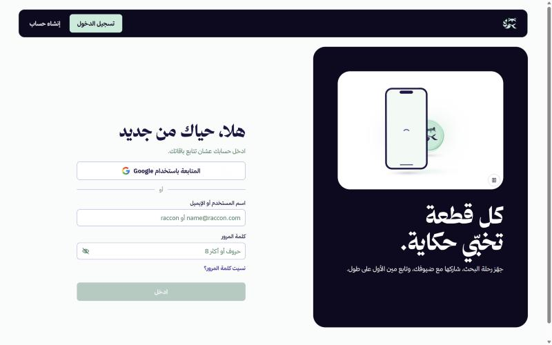
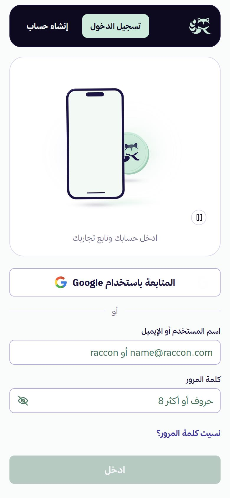
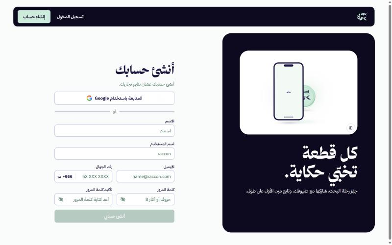
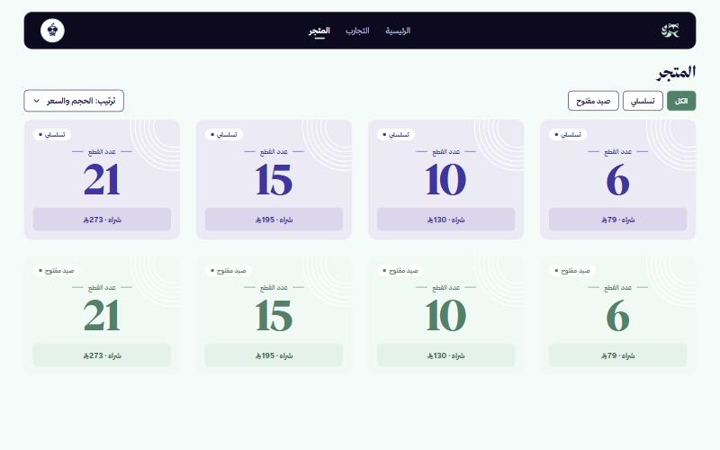
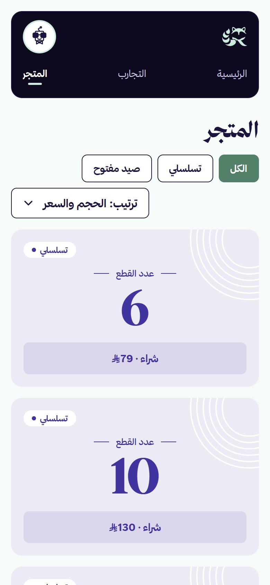
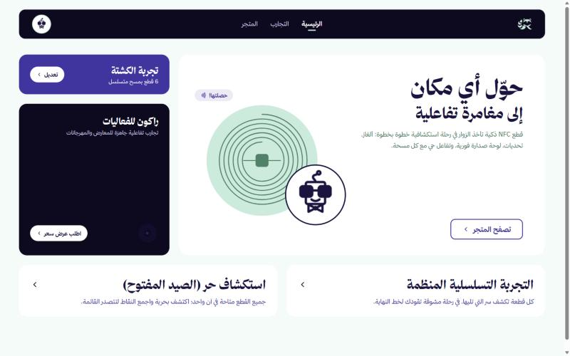
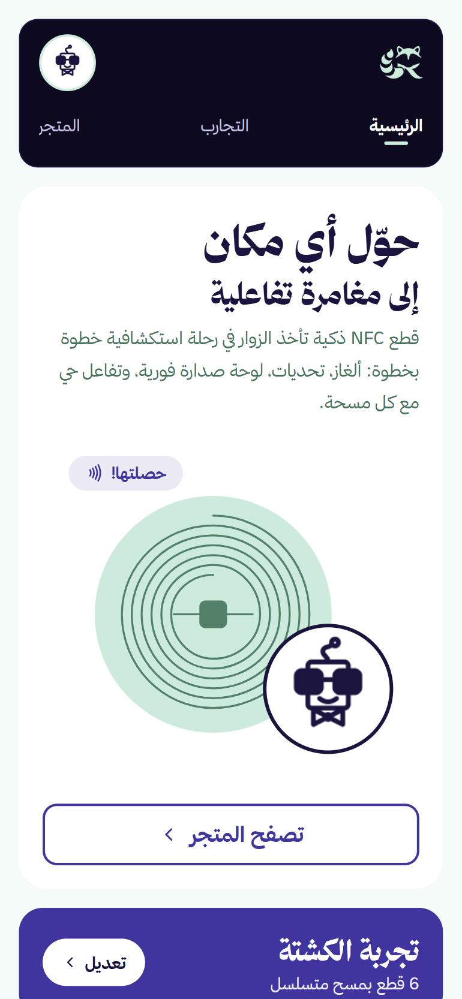
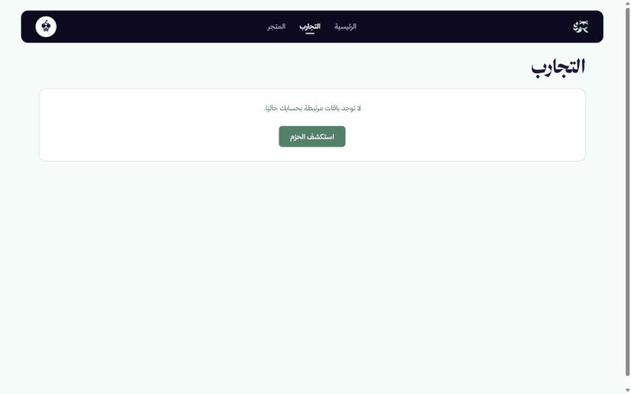
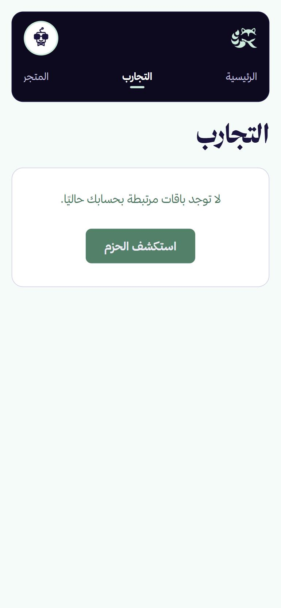

# Stage 4: MVP Development and Execution (Raccon)

| Member | Role |
|---|---|
| Eman Hamdan | Project Manager, UI/UX, frontend |
| Abdulrahman Alsalhi | Solution Architect, frontend |
| Ghaida Alsabti | QA, backend |
| Osama Alhamdan | DevOps, full-stack, Source Control Manager |

**Period covered:** 3 October 2026 to 21 November 2026 (one setup sprint and four development sprints).

**Sources:** the team's Trello board (cards, checklists and column history), the GitHub repository (all branches and 49 pull requests), GitHub Actions runs, stand-up notes, the Stage 2 MoSCoW table and the Stage 3 user stories.

## Deliverable links

| Deliverable | Link |
|---|---|
| Sprint planning | [Section 2](#2-sprint-planning) and the Trello board: https://trello.com/b/DQxxyR2i/raccon |
| Sprint reviews | [Section 3](#3-sprint-reviews) |
| Retrospectives | [Section 4](#4-retrospectives) |
| Source repository | https://github.com/t8pr/Raccon |
| Pull requests | https://github.com/t8pr/Raccon/pulls?q=is%3Apr |
| Bug tracking | [Section 5](#5-bug-tracking) |
| Testing evidence and results | [Section 6](#6-testing-evidence-and-results) and the CI runs: https://github.com/t8pr/Raccon/actions |
| Production environment | https://raccon.app (frontend on Cloudflare Pages, deployed automatically from `Dev`; backend API on Render) |

---

## 1. How we worked

### 1.1 Practices

| Practice | How it was applied |
|---|---|
| Sprints | One setup sprint (10 days) and four development sprints of one to two weeks each (Section 2.2). |
| Task tracking | The Trello board holds one card per user story (US-01 to US-23) and per technical story (TS-00, TS-100). Cards move through **backlog → in dev → code review → UAT → Done → MERGED**, and a **Bug** column holds stories that failed QA. Each story card has **Backend**, **Frontend** and **QA** checklists, labels (back-end, front-end, design, Owner, Player, Admin) and assigned members. |
| Branching | `Dev` is the integration branch and is deployed to production (raccon.app) by Cloudflare Pages. `main` is the stable release branch. Each user story or fix gets its own branch (`US-xx`, `UC-xx`, `TS-xx`, `fix/...`, `refactor/...`) created from `Dev`. |
| Pull requests | Every change reaches `Dev` through a pull request, and `Dev` is promoted to `main` through a release pull request at milestones (#10, #31 and #43). |
| Commit convention | `feat:`, `fix:`, `refactor:`, `chore:` and `style:`, as defined in our [SCM and QA plan](https://github.com/t8pr/Raccon/blob/Dev/Mentors/Paper/scm-qa.md). |
| Continuous integration | Two GitHub Actions workflows: [`backend-unit-tests.yml`](https://github.com/t8pr/Raccon/blob/Dev/.github/workflows/backend-unit-tests.yml) runs the backend tests on every pull request into `Dev` or `main`, and [`discord-dev-merge.yml`](https://github.com/t8pr/Raccon/blob/Dev/.github/workflows/discord-dev-merge.yml) notifies the team on Discord after every merge into `Dev`. |
| Communication | Daily in-person stand-ups at Holberton (Section 1.3), and Discord for remote stand-ups and merge notifications. |

### 1.2 User story numbering

Trello cards and branch names number the stories slightly differently from the Stage 3 document, because Log In and Log Out were merged into one card. This document uses the **Trello** numbers.

| Trello / branch | Stage 3 | Story |
|---|---|---|
| US-01 | US-01 | Registration |
| US-02 | US-02, US-03 | Log In and Log Out |
| US-03 | US-04 | Forgot Password |
| US-04 | US-05 | Manage Account |
| US-05 | US-06 | Claim a Purchased Package |
| US-06 | US-07 | View and Manage Purchased NFC Packages |
| US-07 | US-08 | NFC Package Customization |
| US-08 | US-09 | Customize Tag Content |
| US-09 | US-10 | Edit a Saved Package Configuration |
| US-10 to US-12 | US-11 to US-13 | Configure Freeze, Boom and Choose Traps |
| US-13, US-14 | US-14, US-15 | Preview Sequential and Open Hunt Tag Experience |
| US-15 | US-16 | Scan a Hashed NFC Tag |
| US-16, US-17 | US-17, US-18 | View Successful Sequential and Open Hunt Scan Result |
| US-18, US-19 | US-19, US-20 | Experience a Freeze Trap and a Boom Trap |
| US-20 | US-21 | View Leaderboard |
| US-21 | US-22 | Prepare an NFC Package |
| US-22 | (supporting operation) | Generate NFC Packages |
| US-23 | (added in Stage 4) | Manage Raccon Users |

### 1.3 Stand-ups and progress monitoring

The team holds a short stand-up every day, in person at Holberton or in the Discord **stand-up** voice channel when a member is remote. Each member shares what they finished, what they will do next and any blockers, and the team agrees on decisions at the end. Not every stand-up was written down. The Project Manager recorded the seven below because they contained decisions or changes to the plan.

| Date | Sprint | Progress reported | Decisions and adjustments |
|---|---|---|---|
| 21 Oct | 2 | Figma mockups and the logo were finished and reviewed with mentors. Registration, login (US-01, US-02) and the welcome page were done, and the backend was about 80% complete. | The MVP has no timer toggle and no hashing toggle, because tags are always hashed. A backend developer would support the frontend. A frontend Dockerfile and a roadmap were added to the plan. |
| 29 Oct | 2 | The store, account management and half of the claim flow were done, as were forgot password, the backend refactor, event editing and the Google client. | Next: claim, the admin frontend, the home page and the customization page. The backend would expose scores, fix the Open Hunt counter and handle redirects between Raccon domains. |
| 4 Nov | 3 | The admin page, customization layout and data fetching, the NFC factory tool and the reset endpoint were done. | The frontend structure refactor was planned, with a walkthrough for the team. New endpoints were added for deleting packs and managing users, tag links were made harder to guess, and a factory session was scheduled. |
| 10 Nov | 3 | Customization, the GitHub Actions workflow, the dynamic scan journey and image upload were done. | Next: the scan pages, a full user-journey check and the login page design. Store checkout would use Ramz while experiences stay in our backend. A real-time leaderboard was planned that does not overload the database. |
| 11 Nov | 4 | The login page, the intro animation, the store design, Ramz and the Cloudflare integration with raccon.link were done. | Designs are finalized before implementation starts. Next: the scan pages, the claim (master auth) endpoint, the real-time leaderboard and stronger forgot-password protection. |
| 15 Nov | 4 | The scan pages, store pages, leaderboard, DNS and Ramz were done. | A pair session was held to update the npm packages. Next: Google sign-in, admin delete endpoints, "My experiences" for admins, Redis hosting, unit tests and CI/CD, and the claim preview endpoint. |
| 17 Nov | 4 | The frontend tests and refactor, register, login, Google sign-in, the backend tests, the claim preview endpoint and the Ramz design were done. | Next: a leaderboard with user ranking and the top 10, Redis hosting, protection of the forgot-password endpoint against abuse, and secure sessions with HttpOnly cookies. |

---

## 2. Sprint planning

### 2.1 Prioritization (MoSCoW, from Stage 2)

| Priority | Scope |
|---|---|
| **Must have** | Authentication, NFC tag packages, dashboard, experience modes (Sequential and Open Hunt), password reset, smart links, customer profile, NFC tag and package deactivation |
| **Should have** | Leaderboard, smart-link hashing and optional device binding, up to three post-configuration edits per NFC tag |
| **Could have** | UI animations and transitions, a congratulation screen, history and favorites, notifications |
| **Won't have** | Loyalty program, maps and location-based features |

### 2.2 Sprint plan

| Sprint | Dates | Goal | Main tasks | Priority | Owners | Dependencies |
|---|---|---|---|---|---|---|
| **Sprint 0** | 3 Oct to 12 Oct | Setup and design foundations | Docker, configuration, Alembic migrations, Axiom logging, registration rules, profile and change-password endpoints; design tokens, brand, logo and the account screens | Must | Osama (infrastructure, endpoints), Ghaida (change password), Eman (design) | Infrastructure and design tokens come before feature work. |
| **Sprint 1** | 13 Oct to 19 Oct | Accounts | Pack, tag and event tables; CORS; forgot password (US-03); registration fix (US-01); login page (US-02) | Must | Ghaida (data model), Osama (CORS, password reset, registration), Abdulrahman (login page) | The data model comes before any pack, event or scan feature. |
| **Sprint 2** | 20 Oct to 31 Oct | Backend architecture, OAuth and editing | Logging; user model fields (US-01); sign-in validation and Google button (US-02); first release to `main`; N-tier refactor; event editing (US-09); Google OAuth; admin pack list (US-21); home redesign and role-based navbar | Must, Should | Ghaida (logging, refactor, OAuth), Osama (US-09, US-21), Abdulrahman (US-02), Eman (frontend pages) | The N-tier refactor comes before new services, and OAuth before the Google button. |
| **Sprint 3** | 1 Nov to 9 Nov | Packs, claim, customization and scan | Core system; store and claim (US-05, US-06); factory (pack generation); customization (US-07, US-08); reset event and scan service (US-15); email validation fix (US-01); CI pipeline; scan page (US-16 to US-19); image upload; second release to `main` | Must | Ghaida (core, factory, scan service, images, CI), Abdulrahman (store, claim, customization), Osama (scan page, email validation), Eman (customization styling, admin pages) | The factory comes before claim, claim before customization, and the scan service before the scan page. |
| **Sprint 4** | 10 Nov to 21 Nov | Leaderboard, admin, quality and polish | Real-time leaderboard (US-20); profile page; Ramz store links; backend unit tests; leaderboard refactor; pack preparation and TXT export of claim links (US-21, US-22); database improvements; rebuild codes; third release to `main`; frontend refactor with automated tests; auth, store and admin redesign | Should, Could | Osama (leaderboard, unit tests), Ghaida (US-22, rebuild codes, database), Abdulrahman (profile, refactor, tests, fixes), Eman (auth, store and admin redesign) | Unit tests come before the refactor, and the new frontend structure before the redesigned pages. |

### 2.3 Responsibilities

| Member | Responsibilities in Stage 4 |
|---|---|
| Eman Hamdan | Sprint planning and tracking on Trello, stand-up notes, Figma designs (accounts, store, admin, claim journey) and frontend pages (home, navbar, accounts, store, admin) |
| Abdulrahman Alsalhi | Login, store, claim, customization and profile pages, the feature-based frontend structure and the frontend test suite |
| Ghaida Alsabti | Data model, N-tier backend, Google OAuth, factory, scan service, image storage, CI pipeline, pack preparation, rebuild codes and releases to `main` |
| Osama Alhamdan | Repository and branch management, CORS, password reset, event editing, admin APIs, scan page, real-time leaderboard and backend unit tests |

---

## 3. Sprint reviews

At the end of each sprint, the team reviewed the work merged into `Dev` against the sprint goal. Each review lists what was delivered and the pull requests that delivered it.

### 3.1 Sprint 1 review (19 Oct)

| Delivered | Pull request |
|---|---|
| Pack, tag and event tables with migrations | #1 |
| CORS configuration for the frontend | #2 |
| Password reset with email notifications | #3 |
| Avatar field on users (registration fix) | #4 |
| Login page | #5 |

**Result:** users can register, log in and reset their password, and the database is ready for packs and events.

### 3.2 Sprint 2 review (31 Oct)

| Delivered | Pull request |
|---|---|
| Logging for pack generation and claim actions | #7 |
| Creation date on users and updated event schemas | #8 |
| Sign-in and sign-up validation, Google button | #9 |
| **Release 1 to `main`:** registration and login | #10 |
| Backend refactor to an N-tier structure (routers, services, repositories) | #11 |
| Event editing API | #12 |
| Google OAuth on the backend | #13 |
| Work in progress merged into `Dev` | #14 |
| Admin list of all packs | #15 |
| Frontend updates from Eman's fork | #16 |

**Result:** the first stable release reached `main`, and the backend was reorganized so new features can be added safely.

### 3.3 Sprint 3 review (9 Nov)

| Delivered | Pull request |
|---|---|
| Core system | #17 |
| Store and claim pages | #18 |
| Home redesign, role-based navbar and admin experiences pages | #19 |
| Factory (pack and tag generation) | #20 |
| Rename-event API and dynamic packages page | #22 |
| Customization page and styling | #24, #26, #27 |
| Reset-event API and NFC scan handling | #25 |
| Email validation fixes | #28, #29 |
| CI workflow for backend tests | #30 |
| **Release 2 to `main`** | #31 |
| Scan page with scan results and traps | #32 |
| Image upload with a storage service | #33 |

**Result:** an owner can claim a pack, customize it and play it by scanning its tags.

### 3.4 Sprint 4 review (21 Nov)

| Delivered | Pull request |
|---|---|
| Real-time leaderboard | #34 |
| Profile page | #35 |
| Ramz links on the store page; pack names editable from the customization page | #36 |
| Backend unit tests | #37 |
| Leaderboard refactor | #38 |
| Pack preparation and TXT export of claim links | #39 |
| Database improvements | #41 |
| Rebuild codes | #42 |
| **Release 3 to `main`** | #43 |
| Account pages redesign and Google sign-in on the new frontend structure | #44 |
| Customization page, session token and Google button fixes | #45 |
| Return to the claim page after login | #46 |
| Confirmation dialog after account deletion | #47 |
| Store and admin redesign, branded sort menu and hover states | #48, #49 |

**Result:** 20 of the 23 user stories are merged, and the frontend has a feature-based structure covered by 595 automated tests.

---

## 4. Retrospectives

### 4.1 Sprint 1

- **What worked:** the pack, tag and event tables were ready early, so later stories had a stable base.
- **What did not:** PR #1 combined six user stories in one branch, which made it hard to review.
- **What we changed:** one branch per user story.

### 4.2 Sprint 2

- **What worked:** the first release reached `main`, and the N-tier refactor made the backend easier to extend.
- **What did not:** a release to `main` was opened before `Dev` was ready (PR #6, closed without merging).
- **What we changed:** releases to `main` happen only after the team has checked `Dev` together.

### 4.3 Sprint 3

- **What worked:** this was the busiest sprint (15 merged pull requests), and CI now runs the backend tests on every pull request.
- **What did not:** two feature branches were merged into each other instead of into `Dev` (PRs #22 and #23), which caused confusion about where the work was.
- **What we changed:** every branch starts from the latest `Dev` and targets `Dev`.

### 4.4 Sprint 4

- **What worked:** backend unit tests and 595 frontend tests were added, and the frontend moved to a feature-based structure. Pair sessions and a walkthrough of the new structure helped the team work faster.
- **What did not:**
  - Many pull requests were merged on the same day (21 Nov), and only one (#35) had a reviewer assigned, although our SCM plan asks for one approval per pull request.
  - Pull requests were merged with merge commits rather than squashed as the SCM plan describes.
  - PR #48 was merged into `main` instead of `Dev` by mistake. The team was informed, and the same work was merged into `Dev` in PR #49.
  - Some files with Windows line endings (CRLF) appeared as fully changed in pull requests.
  - Developers asked for designs to be final before implementation starts.
- **What we changed:**
  - Every pull request gets a reviewer before it is merged.
  - The base branch is checked before a pull request is opened.
  - LF line endings will be enforced with a `.gitattributes` file.
  - Each page's design is handed off in Figma before coding starts.

---

## 5. Bug tracking

Bugs are tracked in three places:

1. **Trello:** a story moves to the **Bug** column when QA finds a problem and returns to **MERGED** when it is fixed. Each problem is listed in the story's **QA** or **Bugs** checklist.
2. **GitHub:** each fix goes through a `fix:` pull request.
3. **Automated tests:** known bugs that are not fixed yet are written as expected-failure tests (`test.fails`), so they appear in every test run until they are fixed.

### 5.1 Bug column history (Trello)

| Story | Moved to Bug | Back to MERGED | Problems found |
|---|---|---|---|
| US-01 Registration | 2 Nov | 4 Nov | Email format was not validated (QA case TC-05). |
| US-04 Manage Account | 4 Nov | 5 Nov | Username and name had no maximum length. A user could delete their account while they still had an event. |
| US-09 Edit a Saved Package Configuration | 9 Nov | 11 Nov | Adding an image to a tag did not enable the Save button. The "resetting the Open Hunt event is required" error is not handled (still open, K-07). |

### 5.2 Fixed bugs

| ID | Bug | Fix | Owner | Sprint |
|---|---|---|---|---|
| B-01 | Registration did not store the user's avatar | PR #4 | Osama | 1 |
| B-02 | Sign-in and sign-up accepted invalid data | PR #9 | Ghaida | 2 |
| B-03 | Email format was not validated at registration | PR #28, #29 | Osama, Ghaida | 3 |
| B-04 | Wrong title in the CI notification message | PR #30 | Ghaida | 3 |
| B-05 | Username and name had no maximum length | Trello US-04 | Osama, Abdulrahman | 3 |
| B-06 | A user could delete their account while they had an event | Trello US-04 | Osama, Abdulrahman | 3 |
| B-07 | Adding an image to a tag did not enable the Save button | Trello US-09 | Ghaida, Osama | 3 |
| B-08 | Customization page, session token and Google button problems | PR #45 | Abdulrahman | 4 |
| B-09 | After buying a pack, login did not return the user to the claim page | PR #46 | Abdulrahman | 4 |
| B-10 | No confirmation was shown before signing out a deleted account | PR #47 | Abdulrahman | 4 |
| B-11 | The Google button showed a loading spinner during a normal sign-up | PR #44 | Eman | 4 |
| B-12 | Scan links lost their signature when switching between login and register | PR #44 | Eman | 4 |

### 5.3 Open bugs

| ID | Bug | Where | Evidence |
|---|---|---|---|
| K-01 | A short password shows no error, because the error depends on the wrong field | Login form | `LoginPage.int.test.jsx` (expected failure) |
| K-02 | The hint image message says 2048 px, but the real limit is 1200 px | Customization | `prepareHintImage.test.js` (expected failure) |
| K-03 | After saving an experience name, keyboard focus is lost | Customization | `CustomizationPage.int.test.jsx` (expected failure) |
| K-04 | If logout fails, screen readers cannot read the error message | Profile menu | `AppNavbar.test.jsx` (expected failure) |
| K-05 | An invalid NFC tag shows a generic error instead of an "invalid tag" message | Scan page | Manual testing |
| K-06 | Claiming a pack the user already owns returns HTTP 400 instead of success | `backend/services/pack_service.py` | Code review |
| K-07 | The "resetting the Open Hunt event is required" error is not handled | Edit page (US-09) | Trello QA checklist |
| K-08 | Google sign-in is blocked on production with "Error 400: origin_mismatch", because https://raccon.app is not listed as an authorized JavaScript origin of the Google OAuth client | raccon.app login and register | Final QA on production, 21 Nov |

**Summary:** 12 bugs fixed and 8 open. K-08 affects Google sign-in only; users can still register and log in with a username and password, so none of the open bugs blocks the main user journey.

---

## 6. Testing evidence and results

### 6.1 Automated tests

| Layer | Tools | Scope | Result |
|---|---|---|---|
| Backend unit tests | pytest | Auth, event, journey (scan) and pack services | 21 tests |
| Backend integration tests | pytest with a test PostgreSQL database | Auth routes | 2 tests |
| Frontend unit and component tests | Vitest, React Testing Library | Utilities, validation and shared UI components | Included in the frontend total |
| Frontend page tests | Vitest, MSW (mock API), user-event | Account, home, store, claim, customization, packages, scan, profile and admin pages | Included in the frontend total |
| **Frontend total** | | 57 test files | **595 tests: 591 passed, 4 expected failures (K-01 to K-04)** |
| Production build | react-scripts | Frontend bundle | Builds with no errors |

### 6.2 Continuous integration

| Workflow | Trigger | Runs since 5 Nov | Result |
|---|---|---|---|
| Backend tests (`backend-unit-tests.yml`) | Every pull request into `Dev` or `main` | 16 | All passed. Each run publishes a JUnit report as the **Backend test results** check. |
| Discord merge notification (`discord-dev-merge.yml`) | Every merge into `Dev` | 16 | All passed |

All runs: https://github.com/t8pr/Raccon/actions

Cloudflare Pages deploys every push to `Dev` to production (raccon.app) and every push to `main` to a preview site (main.raccon.pages.dev). The deployments for the latest merges (PR #48 and #49) passed.

### 6.3 How to run the tests

The backend tests need a PostgreSQL test database and the environment variables listed in `backend-unit-tests.yml` (`DATABASE_URL`, `SECRET_KEY`, `RESEND_API_KEY`, `MAX_EDIT_LIMIT`, `REDIS_URL`).

```bash
# backend
cd backend
pip install -r requirements.txt
python -m pytest tests -v

# frontend
cd frontend/raccoon
npm install
npm test
```

### 6.4 Final integration and manual QA

Manual test cases are written in each story's QA checklist on Trello and are ticked when they pass.

| Story | Test cases | Result |
|---|---|---|
| US-01 Registration | TC-01 valid registration; TC-02 username or email already taken; TC-03 invalid name, username or email; TC-04 missing field; TC-05 email format | 5 of 5 passed (TC-05 failed first and was fixed, B-03) |
| US-02 Log In and Log Out | TC-01 valid login; TC-02 invalid username; TC-03 invalid email format; TC-04 empty fields; TC-05 unregistered user; TC-06 redirect after logout | 6 of 6 passed |
| US-04 Manage Account | TC-01 edit account fields; TC-02 field length validation | 2 of 2 passed (B-05 and B-06 found and fixed) |
| US-08 Customize Tag Content | TC-01 cancel an edit | 1 of 1 passed |
| US-09 Edit a Saved Package Configuration | TC-01 edit an unfinished Open Hunt event; TC-02 adding an image enables Save; TC-03 reset-required error | 2 of 3 passed, 1 open (K-07) |
| US-12 Configure Choose Trap | TC-01 tag behavior after a trap is chosen | 1 of 1 passed |
| US-16, US-17 Scan results | TC-01 scan data accuracy; TC-02 simultaneous scans | Pending |
| US-18 Experience a Freeze Trap | TC-01 freeze data accuracy; TC-02 behavior after the freeze ends | Pending |
| US-20 View Leaderboard | TC-01 real-time update; TC-02 data accuracy; TC-03 equal points ordered by name | Pending |

**Summary:** 17 manual test cases passed, 1 is open and 9 are pending.

### 6.5 Production screenshots

Taken on https://raccon.app on 21 Nov 2026, at laptop (1440 px) and phone (390 px) sizes.

| Page | Laptop | Phone |
|---|---|---|
| Login |  |  |
| Register |  | |
| Store |  |  |
| Home (signed in) |  |  |
| Experiences (signed in, no packs yet) |  |  |

---

## 7. Progress metrics

### 7.1 Pull requests, releases and bugs

| Metric | Sprint 1 | Sprint 2 | Sprint 3 | Sprint 4 | Total |
|---|---|---|---|---|---|
| Pull requests merged | 5 | 10 | 15 | 15 | 45 |
| Releases to `main` | 0 | 1 (#10) | 1 (#31) | 1 (#43) | 3 |
| Bugs fixed | 1 | 1 | 5 | 5 | 12 |

Four pull requests were closed without merging: #6, #21, #23 and #40.

### 7.2 Velocity (stories moved to MERGED on Trello)

| Sprint | Stories merged | Count |
|---|---|---|
| Sprint 2 (by 31 Oct) | US-01, US-02, US-04 | 3 |
| Sprint 3 (by 9 Nov) | US-03, US-05, US-06, US-07, US-08, US-09, US-15 | 7 |
| Sprint 4 (by 21 Nov) | US-10, US-11, US-12, US-16, US-17, US-18, US-19, US-20, US-21, US-22 | 10 |
| **Total** | | **20 of 23 stories** |

**Task completion:** 129 of the 152 checklist items on story cards are done (85%).

### 7.3 Remaining work

| Card | Status |
|---|---|
| US-13, US-14 Preview Sequential and Open Hunt Tag Experience | Backlog |
| US-23 Manage Raccon Users | In development |
| TS-00 Core Application Architecture and Infrastructure | In development (all 16 backend items done) |
| TS-100 Improvements | Backlog (3 of 6 items done) |
| Global leaderboard and leaderboard by client | Backlog |
